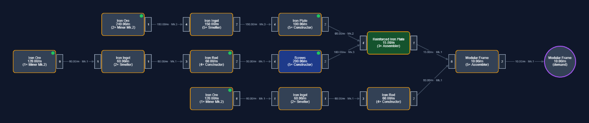
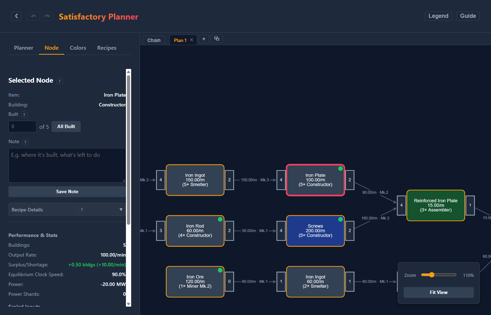
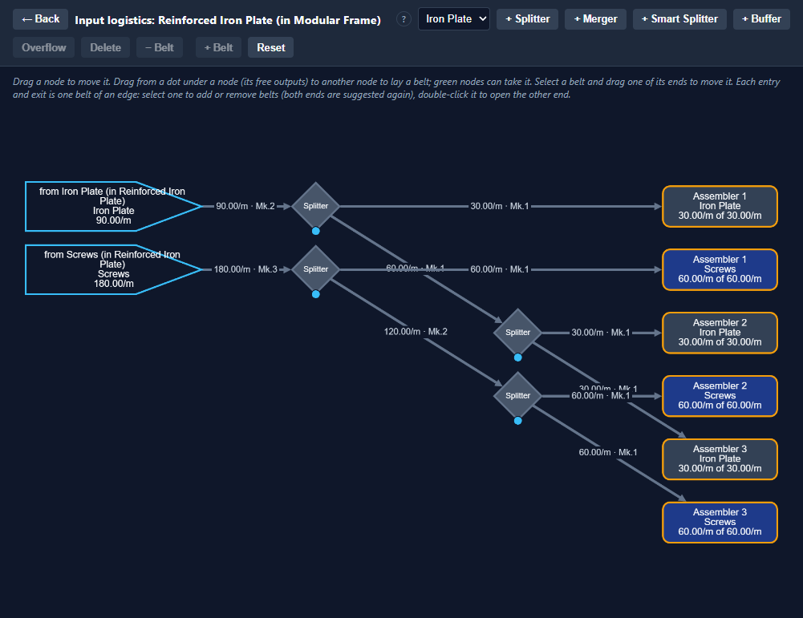
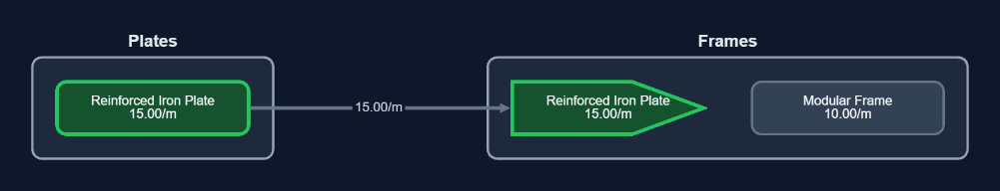
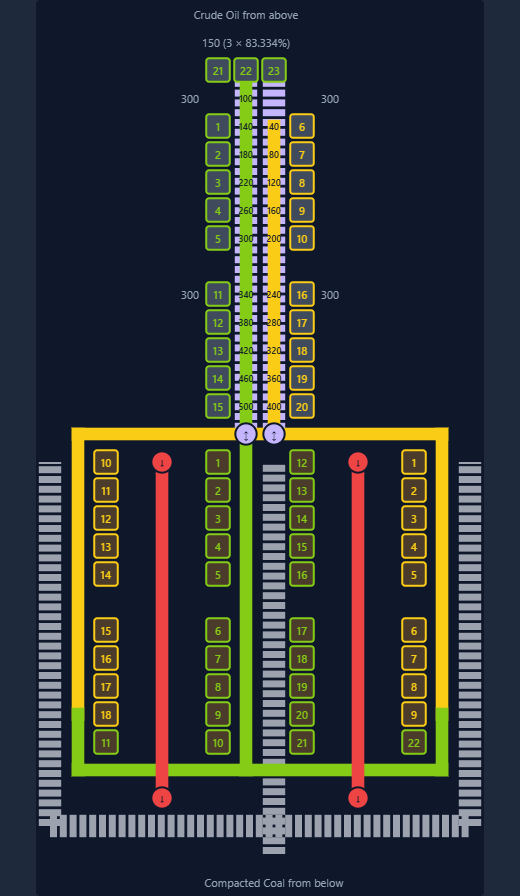

# User guide

sftools plans production in [Satisfactory](https://www.satisfactorygame.com/). You say what you want to make and how fast. It works out every building down to the miners, and the belts, splitters and mergers between them. You then adjust the plan to the way you want to build it.

This guide is also in the app: the **Guide** button in the header opens it, and the **?** links in the side panel open it at the matching section.

## Getting started

This walkthrough plans 10 Modular Frames a minute.

1. On the **Planner** tab, under **Demand Targets**, type `Modular Frame` in the first row (the field suggests item names) and `10` as the rate.
2. Click **Calculate**. The graph shows the production chain: the Modular Frame assemblers on the right, fed by Reinforced Iron Plate and Iron Rod, down to the Iron Ore miners on the left.

   

3. Read a node: `Iron Plate`, `100.00/m`, `(5× Constructor)` means five Constructors making 100 Iron Plates a minute. The plan only needs 90, so the node has a green dot (a little more than needed). The **Legend** button in the header explains every color and mark.
4. Click the Iron Plate node. The side panel switches to the **Node** tab: its recipe, buildings, power, inputs, and what you can change.

   

5. Fix the surplus: click **⚖️** next to the clock boxes. The node now runs 4 Constructors, the last one at 150% with a power shard, making exactly 90. See [Clock speeds](#clock-speeds).
6. Iron Rod appears twice (for the frames, and for the screws). Drag one Iron Rod node onto the other to merge them into one node of 8 Constructors. See [Merging nodes](#merging-nodes).
7. When you build it in the game, enter how many buildings you've built on each node (**Built**). Done nodes fade, so what's left stands out. See [Built marks](#built-marks).

The plan is saved in your browser as you go. **Save Book** downloads all your plans as one file.

## The screen

- **Header:** hide or show the side panel (❮), undo and redo (↶ ↷), and the **Legend** and **Guide** buttons.
- **Side panel**, with four tabs:
  - **Planner:** what the plan makes (demand targets) and gets from outside (inbound production), saving and loading, the plan's note, and what you've unlocked for logistics.
  - **Node:** whatever you clicked in the graph: a node, an edge, a by-product edge or a logistics node.
  - **Colors:** the color of each item's nodes.
  - **Recipes:** the recipe each item uses by default.
- **Tab strip** above the graph: your plans, one per tab, and the **Chain** tab, which shows how they feed each other.
- **Graph:** scroll to zoom, drag the background to pan, **Fit View** to see it all.

## Demand targets and inbound production

**Demand targets** are what the plan makes, each at a rate per minute. **+ Add Item** adds a row and ✕ removes one. **Calculate** applies the rows.

Each demand target is a purple circle in the graph, fed by the node that makes the item.

**Inbound production** is what the plan gets from outside, e.g. from another factory, at a given rate. It covers demand for the item first, from the top of the chain down, before anything is produced here. A node left with nothing to make disappears, with its inputs.

Example: the Modular Frame plan needs 15 Reinforced Iron Plates a minute. Add an inbound row `Reinforced Iron Plate`, `15` and Calculate. The plates come in on a sky-blue node, and the plate, screw and iron-plate branch is gone. Its node shows how much of the inbound is used; a green dot means some is left over.

To feed this plan from another of your plans, see [The Chain tab](#the-chain-tab) and [Move Branch to Inbound](#move-branch-to-inbound).

## Reading the graph

- **Nodes** are groups of the same building running one recipe. The label shows the item, the rate, and the buildings, e.g. `(5× Constructor)`. `(A)` after the item means an alternate recipe. A line like `3×100% + 1×150%` shows clock speeds, and the next line the power shards they need.
- **Dot, top right:** green makes a little more than needed, blue has a whole building or more to spare, red makes less than needed.
- **Edges** run from a supplier to the node it supplies, labelled with the rate and the belt it needs, e.g. `36.00/m · Mk.3`.
- **Built, top left:** a ✓ when all the node's buildings are built, or e.g. `6/8`.

The **Legend** lists them all, including the borders and by-product edges.

## Working with a node

Click a node to open it on the **Node** tab:

- **Selected Node:** the item, the building, and **Built** (see [Built marks](#built-marks)).
- **Note:** your note on the node (see [Notes](#notes)).
- **Recipe Details:** the recipe, **Switch Recipe** and **Prefer** (see [Recipes](#recipes)).
- **Performance & Stats:** buildings, output, surplus or shortage, the equilibrium clock speed, power and power shards.
- **Scaled Inputs:** what the node takes, at its rate.
- **Clock Speed:** see [Clock speeds](#clock-speeds).
- **Unmerge Node:** on a merged node (see [Merging nodes](#merging-nodes)).
- **Move Branch to Inbound…:** see [Move Branch to Inbound](#move-branch-to-inbound).

Hold the mouse on a node for a moment to see its note, if it has one.

## Merging nodes

The same item is often made in several places in a plan, e.g. Iron Ingot for the plates and for the rods. To build them as one group, drag one node onto another node of the same item. The merged node makes what both made, with one set of buildings, and feeds every node the two fed.

Example: in the Modular Frame plan, the two Iron Rod nodes have 4 Constructors each, for 60 and 50 rods a minute. Merged, they're one node for 110 a minute with 8 Constructors (7.33 needed).

A merged node runs the recipe of the node you dropped onto; the panel warns you when the two differed. **Unmerge Node** splits them back out. **Clear Merges** on the Planner tab undoes every merge.

## Recipes

**Switch a node's recipe:** open **Recipe Details** on the Node tab and pick one under **Switch Recipe**. Inputs both recipes use keep their adjustments; inputs the new recipe doesn't use are removed, with everything under them, and new ones are added.

**Preferred recipes** apply to every node of an item, in every tab:

- **Prefer** on a node makes its current recipe the item's preferred one.
- The **Recipes** tab lists every item with more than one recipe, ores included (node purity and miner), each with its default. Pick another to prefer it. Changed ones are highlighted; **Changed only** shows just those, and **All to Default** resets them.

Example: prefer **Alternate: Cast Screws** for Screws. Every Screws node in every plan now makes screws from Iron Ingot, unless a node has a recipe switched of its own.

New nodes of iron ore use a normal node with a Miner Mk.2 by default. Preferred recipes are kept in your browser and in Save Book.

## Clock speeds

Under **Clock Speed (%)**, a node has two boxes:

- **All:** the clock of all its buildings (100% when empty).
- **Last:** a different clock for the last building only.

**Apply Clock Speeds** applies them. The number of buildings always follows from the demand and the clocks, and the inputs follow too. Power accounts for the clocks; above 100% each building needs power shards, one per 50%. Nodes with clocks set have a dashed cyan border.

**⚖️ fits the last building to the demand**, with the rest at 100%, so nothing is left over:

- It prefers one building fewer, with the last at up to 150% (one power shard).
- Otherwise it underclocks the last building.
- It avoids ending on 5 or 7 buildings, which are hard to balance, by using one fewer with the last at up to 200% (two shards).

Example: Iron Plate for the frames needs 4.5 Constructors. ⚖️ sets 4 Constructors, the last at 150%. At 5.3 it would set 6 with the last at 30%, since 5 buildings are avoided.

**🚫** clears the node's clocks. **Clear Clock Speeds** on the Planner tab clears them all. The **Equilibrium Clock Speed** under Performance & Stats is the All clock at which the node makes exactly what's needed.

## By-products and the Sink

Some recipes make a second product, e.g. Heavy Oil Residue from the Plastic recipe. Every by-product goes to one round **Sink** node, on a dotted edge with its rate. The Sink counts its power. Fluids can't be sunk in the game: their edges turn red and the Sink gets a thick red border until you deal with them.

Heavy Oil Residue is the exception: what's left of it is **burned for power**, as in the game. It goes to a Refinery running Residual Fuel (60 residue into 40 Fuel a minute), whose Fuel goes to a round **Fuel Generator** node (20 Fuel a minute each, 250 MW). The Refinery is a node like any other, with clocks and Built counts, but always runs Residual Fuel. The Generators have no clocks: there are as many as the Fuel needs, rounded up, and the node says how many the Fuel keeps running, e.g. `4× Fuel Generator, 3.33 fed`. The last ones burn with gaps, which makes the same power on average, so when you make more or less Plastic the count simply follows. The power shown is that average. For residue, the by-product's button reads **Burn for Power** instead of Send to Sink.

**Calculate** uses by-products to cover demand for the same item elsewhere in the plan, shown as dashed sky-blue edges from the maker. Other changes (recipe switches, merges, clocks) don't: a by-product that appears then goes to the Sink.

Click a by-product edge to see what's made, used and sunk, and switch between **Use as Supply** and **Send to Sink**. That choice is kept.

A use that would feed a node above its own maker would be a loop. It isn't applied: the by-product goes to the Sink on a red-orange edge marked `(loop)`. **Solve Loop** on that edge balances the loop, marked `(loop, solved)`. If it can't be balanced, it stays on the Sink and the panel says why.

## Logistics

sftools plans the belts, pipes, splitters and mergers for every node.

**Settings** (Planner tab, Logistics): the highest belt and pipe tiers you've unlocked, and whether you have smart and programmable splitters.

**Logistics nodes:** each node has a small node on each side: inputs on the left, outputs on the right. It shows how many splitters and mergers it has. It's red when something's short or not connected, and dashed when you've edited it. Click one for a summary.

**Edges** are belts or pipes, labelled with the tier they need. An edge that needs more than one belt of the highest tier is amber, e.g. `2× Mk.6`.

**Belts per edge:** click an edge, then **−** / **+** to set how many belts it is, or **Default Belts**. Example: a belt to each Rotor group straight from its own Screws producer, instead of one shared belt with splitters. Each of the edge's belts then has its own exit and entry, and what the producer puts on each belt arrives at that entry.

### The zoomed-in view

Click a logistics node, then **Zoom In**, to see and edit it.

- Buildings (or entries) stand on the left, exits (or buildings) on the right, with splitters (rhombuses) and mergers (squares) between. Every belt shows its rate.
- A building at another clock than the rest, such as the last, partial one, has a cyan border.
- **Move:** drag a node. Positions are kept with the plan.
- **Lay a belt:** drag from one of the dots under a node (its free outputs) to another node. Nodes that can take it turn green.
- **Move a belt:** select it and drag one of its ends.
- **Add parts:** pick the item, then **+ Splitter**, **+ Merger**, **+ Smart Splitter** or **+ Buffer**. **Overflow** makes a smart splitter's selected belt an overflow output.
- **Delete** removes the selected belt or part. **Reset** goes back to the suggested layout.
- Select an entry or exit for **− Belt** / **+ Belt** on its edge; double-click it to open the other end of that belt.
- **← Back** (or Esc) returns to the plan.

Changes that don't fit (a port already used, a belt between different items, a loop) are refused.

**Push and pull:** an output side is pushed: its buildings put out all they make, and splitters share it evenly. An exit shows what lands on its belt, amber when that's more than the other end takes (it backs up). An input side is pulled: buildings take what they need from what the entries bring.

**Suggested layouts:** outputs are grouped by destination; inputs are a manifold. If a change to the plan alters the buildings or edges of a logistics node you edited, it goes back to the suggested layout, with a notice. Undo brings yours back.

## Plan tabs

Each tab is one plan, with its own undo history:

- **+** adds a tab, and **⧉** duplicates the shown one, e.g. to try a variant.
- Double-click a tab to rename it; drag it to move it.
- **✕** closes a tab, asking first when it has a plan.

Logistics settings are shared by all the tabs.

## The Chain tab

The **Chain** tab, left of the plan tabs, shows how your plans feed each other.

Each plan is a box: its inbound production on the left, its demand targets on the right. Drag from a demand target to another plan's inbound production of the same item to link them, meaning that delivery is routed in the game.

Example: plan "Plates" demands 15 Reinforced Iron Plates a minute, and plan "Frames" has them as inbound production. Link the two, and the link shows the rate.

- One plan can feed several, or several can feed one, but not both.
- Nodes show where the rates don't add up: red is short, blue is spare (or more than needed), green matches. Unlinked ones stay plain.
- Nothing changes a plan on its own: the Chain tab only shows and checks.
- Select a link and press **Delete** to remove it. Drag a box to move it; double-click it to open its plan.
- To pass on a by-product, the plan that makes it sets it as a demand target (covered by the by-product, no buildings added), and the other as inbound production.
- A link whose demand target or inbound production is gone from its plan is hidden, and comes back with it. A new link that shares an end with it replaces it.

## Move Branch to Inbound

**Move Branch to Inbound…** on the Node tab moves a node and everything under it to another plan. Its item becomes inbound production of this plan, at the rate its consumers take, so the node and its inputs disappear here.

1. The button works only when one node makes the item (merge them first), and the item isn't a demand target of this plan. When it's disabled, it says why.
2. Pick the destination:
   - **Undefined:** add the demand target there yourself later.
   - **Another tab:** it gets the demand target, linked on the Chain tab.
   - **New tab:** a new plan with just that demand target, linked.
3. Click **Move**.

Example: in the Modular Frame plan, one node makes Reinforced Iron Plate, so the button is enabled. Move its branch to a new tab. "Reinforced Iron Plate" becomes a plan of its own making 15 a minute, and the frames plan gets them as inbound production.

Nothing of the branch's adjustments (recipes, clocks, merges, built marks) carries over: the destination calculates it fresh. Undo in this plan removes the inbound row, but not the destination's demand target.

## Built marks

Record how many of a node's buildings you've built in the game: type the number under **Built**, or click **All Built**.

- A done node fades and gets a ✓; a partly built one shows e.g. `6/8`.
- When the plan grows, a done node shows what's left.
- After a recipe switch, the old count no longer counts, and the panel says so.

**Clear Built Marks** on the Planner tab resets them all.

## Notes

- **Node note:** the **Note** box on the Node tab, saved with **Save Note**.
- **Plan note:** the **Plan Note** box on the Planner tab, with its own Save Note.

Rest the mouse on a node to see its note where the legend is. The selected node's note stays shown until you click the empty graph or select another node.

When a node with a note switches recipe, a dated line is added to it, e.g. `22.10.26: recipe changed from Screws to Alternate: Cast Screws`. A node's note goes when the node leaves the plan; undo brings it back. If you try to leave a note with unsaved changes, you're asked first.

Notes are kept with the plan, so they're in exports and Save Book.

## Colors

The **Colors** tab sets the color of each item's nodes.

- Change a color with its picker.
- **Define** gives any other item a color.
- **×** resets a built-in color, or removes one you defined.
- **Save Colors** applies the changes.

Colors are kept in your browser and in Save Book.

## Reference layouts

**Layouts** in the header opens worked examples to build from: fixed layouts, not plans, so nothing in them changes with your tabs. Each one is a schematic, not to scale: one square is a building's place, pipes are raised over the striped belts on the floor, and the numbers along a pipe are what it carries after each building. Hover a building, pipe or marker to see what it is. A table of the numbers and a note follow the drawing.

The first one, **Crude Oil to Turbofuel power**, refines 1350 Crude Oil/min into Fuel (23 Refineries), then Turbofuel (40 Refineries with Compacted Coal from below), which dives down to 100 Fuel Generators for 25,000 MW. Its Polymer Resin leaves on two belts, to be sunk.

## Saving, loading and undo

- **Saving:** your tabs are saved in your browser as you work.
- **Export Plan** downloads the shown plan. **Save Book** downloads all the tabs in one file, with your preferred recipes and colors.
- **Import** opens a plan in a new tab, or a book in place of all the tabs, asking first. A book's preferred recipes and colors become this browser's.
- **New Plan** clears the shown plan: demands, inbound production and every adjustment. Logistics settings and colors stay.
- **Undo and redo:** ↶ ↷ in the header, or Ctrl+Z and Ctrl+Y (or Ctrl+Shift+Z). They step through the shown plan's changes, up to 50, until the page is reloaded.
